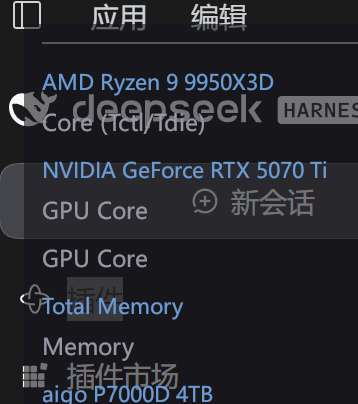

# lhm-panel

轻量级桌面硬件监控面板。从 [LibreHardwareMonitor](https://github.com/LibreHardwareMonitor/LibreHardwareMonitor) 的 Web Server 读取传感器，把 CPU / GPU / 硬盘的温度、占用、频率等显示成一个常驻桌面、可自由缩放的小浮窗。

用 Rust + [egui](https://github.com/emilk/egui) 写成，单个 exe，3.6 MB，无运行时依赖。



## 功能

- **CPU / GPU / 硬盘温度、占用、频率、功耗、风扇转速**，全部来自 LibreHardwareMonitor，覆盖 AMD Zen / Intel / NVIDIA / AMD 显卡
- **按设备分组**：同一设备的传感器收进一组，标题只出现一次
- **勾选式配置**：点右上角 ⚙，从全部传感器里挑要显示的，硬盘名会带设备前缀便于区分
- **阈值自动排除**：NVMe 的 `Warning Temperature` / `Critical Temperature`（如 119°C / 129°C）默认不勾选，避免误判成过热
- **温度变色**：`<55` 绿、`55–70` 黄、`70–82` 橙、`>82` 红
- **无边框半透明浮窗**：上边缘直角、下边缘圆角，整窗任意位置可拖动，按住底边可缩放
- **任务栏有图标，Alt+Tab 不显示**
- **开机自启**（可选，写入 `HKCU\...\Run`）
- 窗口大小、不透明度、字号、刷新间隔、勾选项全部持久化到 `data/config.json`

## 环境要求

| 项目 | 要求 |
|---|---|
| 系统 | Windows 10 / 11 64 位 |
| LibreHardwareMonitor | **0.9.4+**，必须以**管理员身份**运行 |
| LHM Web Server | `Options → Remote Web Server → Run`，端口 `8085` |

> LHM 0.9.6 没有 WMI 接口，所以本程序走它的 HTTP 接口 `http://127.0.0.1:8085/data.json`。
> 不开 Web Server 的话面板会提示「未检测到 LibreHardwareMonitor」。

## 直接使用（免编译）

1. 下载 [`release/lhm-panel.exe`](release/lhm-panel.exe)
2. 放到任意目录运行（首次运行会在同目录生成 `data\config.json` 和 `data\panel.log`）
3. 确保 LibreHardwareMonitor 已按上面的要求跑起来

首次启动会自动勾选一组默认传感器：CPU 封装温度、CPU 总占用、GPU 核心温度、GPU 核心占用、内存占用、风扇转速、硬盘复合温度。

## 从源码构建

```powershell
git clone https://github.com/halucino/lhm-panel.git
cd lhm-panel
cargo build --release
# 产物：target\release\lhm-panel.exe
```

只需要 Rust stable 工具链（MSVC）。依赖已在 `Cargo.lock` 固定。

## 使用说明

| 操作 | 说明 |
|---|---|
| 拖动窗口 | 窗口内任意空白处按住拖 |
| 缩放窗口 | 按住最下面 10px 的底边拖动 |
| 打开设置 | 右下角 `⚙` |
| 退出 | 右下角 `✕` |
| 显示/隐藏某项 | 设置页里按设备 → 类型两级展开，逐项勾选 |

设置页里 `全选` / `清空` / `恢复默认` 三个按钮可以快速调整。

## 数据来源说明

| 指标 | 来源 |
|---|---|
| CPU 温度 | `/amdcpu/0/temperature/*`（`Core (Tctl/Tdie)` 等） |
| CPU 占用 | `/amdcpu/0/load/0`（`CPU Total`） |
| GPU 温度 | `/gpu-nvidia/0/temperature/0`（`GPU Core`） |
| GPU 占用 | `/gpu-nvidia/0/load/0`（`GPU Core`） |
| 内存占用 | `/ram/load/0` |
| 硬盘温度 | `/nvme/N/temperature/0`（`Composite Temperature`） |

## 已知限制

- **仅 Windows**。`wmi` 和 `windows` 依赖是 Windows 专属；Linux / macOS 需要重写传感器采集层。
- **依赖 LibreHardwareMonitor**。不安装它就什么都读不到——因为普通进程无法直接读 AMD 的 SMN 寄存器或 Intel 的 MSR。
- **LHM 必须常驻**。它一退出，面板立刻变成「无数据」。建议在 LHM 里勾选 `Run on Windows startup` + `Start minimized` + `Minimize to tray`。
- **阈值类传感器**（`Warning Temperature` 等）虽然可以在设置里手动勾选，但显示的是报警门限而非实测值，容易误读。

## 排错

| 现象 | 原因 / 处理 |
|---|---|
| 面板显示「未检测到 LibreHardwareMonitor」 | LHM 没运行，或 Web Server 没开 |
| 面板显示「无数据」但 LHM 在跑 | 检查 `http://127.0.0.1:8085/data.json` 能否打开 |
| CPU 温度一直 `--` | LHM 没以管理员运行，读不到 Tctl/Tdie |
| 面板一闪就没了 | 看同目录 `data\panel.log`，通常有 PANIC 记录 |
| 任务栏没图标 | 需要 Windows 10 1809+，`ITaskbarList::AddTab` 在老系统上可能失效 |

## 许可证

[MIT](LICENSE)
